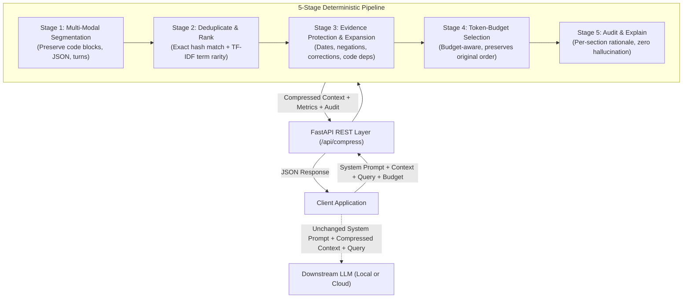

# Context Surgeon

> **Compress LLM Context Without Losing Essential Meaning.**  
> *MITK AI VISION 24H Hackathon | PS-02 | CommVault Challenge — AI/ML Performance Optimization*

---

## 1. Project Overview

**Context Surgeon** is an intelligent, explainable preprocessing layer that sits between your client applications and large language models (LLMs).

When LLM prompts grow bloated with repetitive conversation history, irrelevant paragraphs, duplicate records, and unused code, they inflate API token costs, degrade generation speed, and increase the risk of context window overflow. However, aggressive naive compression frequently discards critical evidence—such as exact dates, numerical quantities, negation constraints (`must not`), later corrections, and code dependencies.

**Context Surgeon solves this challenge locally without requiring an extra LLM call for every request.** It deterministically prunes conversational bloat while rigorously safeguarding essential facts, providing transparent decision reasoning for every retained and removed section.

---

## 2. Architecture Diagram



---

## 3. Core Features

- **Query-Aware Relevance Scoring:** Ranks context segments based on query-term rarity (TF-IDF), entity IDs, and numerical targets instead of arbitrary positional truncation.
- **Conservative Evidence Protection:**
  - **Exact Identifiers:** Preserves specific codes (`ORD-842`, `CUST-204`, `REF-9902`).
  - **Dates & Times:** Preserves delivery dates, meeting times, and milestones.
  - **Negation Preservation:** Protects restrictive clauses (`Port 22 must not be opened`) to prevent critical security inversions.
  - **Later Corrections:** Prioritizes amendments that supersede earlier statements (`revised to 15 October`, `rescheduled to 2 PM`).
  - **Comparative Fact Expansion:** Preserves referenced baseline facts along with corrections so delays and deltas can be accurately computed.
  - **Python Dependency Expansion:** Automatically resolves function dependencies (`calculate_discount` $\rightarrow$ `get_tier_rate`).
  - **Structured Record Protection:** Isolates specific JSON/CSV entities matching the query.
- **Budget-Aware Selection with Safety Warnings:** If an impossible token budget is requested, Context Surgeon refuses to silently drop critical evidence, instead retaining the required facts and returning a transparent budget warning.
- **Immutability Guarantee:** System instructions and user queries remain 100% bit-for-bit unchanged.
- **Zero Paid Dependencies:** Runs 100% locally on standard CPU in sub-10ms latency without requiring API keys or internet access.
- **Complete Explainability Audit:** Every section is tagged with its status (`retained`, `removed`, `deduplicated`), token cost, relevance score, and human-readable decision rationale.

---

## 4. Technology Stack

- **Backend:** Python 3.11+ / 3.14+, FastAPI, Pydantic v2, Uvicorn.
- **Frontend Dev Server:** Vite 5 serving frontend at `http://localhost:5173`.
- **Process Orchestration:** `concurrently` running both Vite and FastAPI concurrently.
- **Tokenizer:** `tiktoken` (cl100k_base byte-pair encoding) with an offline deterministic fallback tokenizer.
- **Frontend Dashboard:** Modern Vanilla CSS3 design system (Dark Charcoal & Teal/Cyan developer palette), Vanilla JavaScript.
- **Testing & Benchmarking:** `pytest`, reproducible JSON benchmark suite (30 categories), CSV/JSON result exporters.

---

## 5. Installation & Setup

### Complete Setup Workflow (Windows Command Prompt / PowerShell)

```cmd
cd path\to\ContextSurgeon
npm install
python -m venv .venv
.venv\Scripts\activate
pip install -r requirements.txt
npm run dev
```

#### On Linux / macOS:
```bash
cd path/to/ContextSurgeon
npm install
python3 -m venv .venv
source .venv/bin/activate
pip install -r requirements.txt
npm run dev
```

---

## 6. Running the Application

### Single Command Launcher:
```cmd
npm run dev
```
This uses `concurrently` to launch both services simultaneously:
1. **Frontend (Vite Server):** [http://localhost:5173/](http://localhost:5173/)
   - Proxies `/api` calls directly to the FastAPI backend at `http://127.0.0.1:8000`.
2. **Backend (FastAPI REST Server):** [http://127.0.0.1:8000/](http://127.0.0.1:8000/)
   - Automatically pre-evaluates the 30 benchmark cases on startup.
3. **Interactive Swagger API Docs:** [http://127.0.0.1:8000/docs](http://127.0.0.1:8000/docs)
4. **Backend Health Endpoint:** [http://127.0.0.1:8000/api/health](http://127.0.0.1:8000/api/health)

Press `Ctrl+C` once in the terminal to gracefully terminate both frontend and backend processes.

---

## 7. API Reference

### `POST /api/compress`
Compresses supporting context based on query relevance and token budget.

#### Example Request:
```json
{
  "system_prompt": "You are a logistics assistant.",
  "context": "Order ORD-842 was promised for 12 October. The delivery was later revised to 15 October. The customer also prefers blue packaging. Hello, thank you for contacting support.",
  "query": "How many days late is order ORD-842?",
  "target_tokens": 40
}
```

#### Example Response:
```json
{
  "system_prompt": "You are a logistics assistant.",
  "query": "How many days late is order ORD-842?",
  "original_context": "Order ORD-842 was promised for 12 October. The delivery was later revised to 15 October. The customer also prefers blue packaging. Hello, thank you for contacting support.",
  "compressed_context": "Order ORD-842 was promised for 12 October.\n\nThe delivery was later revised to 15 October.",
  "original_tokens": 42,
  "compressed_tokens": 24,
  "tokens_removed": 18,
  "reduction_percentage": 42.86,
  "compression_time_ms": 2.34,
  "target_tokens": 40,
  "budget_met": true,
  "warnings": [],
  "sections": [
    {
      "section_id": "sec_001",
      "original_position": 0,
      "source_type": "sentence",
      "preview": "Order ORD-842 was promised for 12 October.",
      "content": "Order ORD-842 was promised for 12 October.",
      "tokens": 12,
      "relevance_score": 15.0,
      "decision": "retained",
      "reason": "Retained. Contains baseline fact referenced by subsequent correction. Contains matching identifier(s): ORD-842.",
      "protection_rules": ["exact_identifier:ORD-842", "date_time_evidence", "referenced_original_fact"],
      "is_protected": true
    },
    {
      "section_id": "sec_002",
      "original_position": 1,
      "source_type": "sentence",
      "preview": "The delivery was later revised to 15 October.",
      "content": "The delivery was later revised to 15 October.",
      "tokens": 12,
      "relevance_score": 12.0,
      "decision": "retained",
      "reason": "Retained. Contains correction or revised update. Key terms match: delivery.",
      "protection_rules": ["date_time_evidence", "later_correction"],
      "is_protected": true
    },
    {
      "section_id": "sec_003",
      "original_position": 2,
      "source_type": "sentence",
      "preview": "The customer also prefers blue packaging.",
      "content": "The customer also prefers blue packaging.",
      "tokens": 9,
      "relevance_score": 0.0,
      "decision": "removed",
      "reason": "Removed (not essential to query or exceeds budget). Unrelated to current query.",
      "protection_rules": [],
      "is_protected": false
    },
    {
      "section_id": "sec_004",
      "original_position": 3,
      "source_type": "sentence",
      "preview": "Hello, thank you for contacting support.",
      "content": "Hello, thank you for contacting support.",
      "tokens": 9,
      "relevance_score": 0.0,
      "decision": "removed",
      "reason": "Removed (not essential to query or exceeds budget). Unrelated to current query.",
      "protection_rules": [],
      "is_protected": false
    }
  ],
  "summary": {
    "total_sections": 4,
    "retained_sections": 2,
    "removed_sections": 2,
    "deduplicated_sections": 0,
    "protected_sections": 2,
    "tokenizer_info": {
      "type": "tiktoken",
      "encoding": "cl100k_base",
      "is_fallback": false
    }
  }
}
```

### Additional Endpoints:
- `GET /api/health` — Checks service status and active tokenizer information.
- `GET /api/benchmarks` — Lists all pre-configured benchmark cases.
- `POST /api/evaluate` — Runs the full benchmark suite.
- `GET /api/benchmarks/results` — Retrieves latest persisted evaluation data.

---

## 8. Python Library Usage

Context Surgeon can be used as a standalone Python library in your own pipelines:

```python
from backend.compressor import compress_context

result = compress_context(
    system_prompt="You are a helpful assistant.",
    context="Supporting context goes here...",
    query="What is the latest delivery date?",
    target_tokens=500
)

print(f"Tokens reduced by {result.reduction_percentage}% in {result.compression_time_ms}ms")
print("Compressed context for downstream LLM:")
print(result.compressed_context)
```

---

## 9. Test Execution

Context Surgeon includes automated unit, integration, and correctness test suites:

```bash
python -m pytest tests/ -v
```

### Test Coverage Highlights:
- `tests/test_rlm_engine.py`:
  - **ContextStore:** Externalized storage, semantic chunking, inverted index keyword search, entity filtering.
  - **SafeExplorationREPL:** Sandboxed execution, timeout enforcement, query-driven candidate discovery.
  - **RLMRecursiveEngine:** Observable trajectory generation, step audits, usage and token statistics.
  - **Mode A vs Mode B:** Distinct execution paths and response schemas.
  - **Auto Mode:** Dynamic threshold switching (<= 1200 tokens fast_local, > 1200 tokens recursive).
  - **Fact & Code Preservation:** Rigorous retention of dependencies, corrections, negations, and IDs in Mode B.
  - **Case 40:** Long document needle retrieval and multi-chapter operations manual pruning.
- `tests/test_genuine_compression.py`:
  - Scenarios A through G: paragraph deduplication, query-driven irrelevant removal, exact dates/numbers, negations, corrections, code dependencies, unique essential contexts, and empty input division-by-zero safety.
  - Verification that manual reduction target sliders and chips are completely removed.
- `tests/test_preservation.py`:
  - Critical correctness tests A through F (dates, negations, corrections, code deps, structured data, impossible budget).
- `tests/test_compressor.py`: Multi-modal segmentation, tokenizer modes, Unicode resilience, large context efficiency.
- `tests/test_api.py`: FastAPI endpoint tests via `TestClient`.
- `tests/test_benchmarks.py`: Benchmark dataset integrity and evaluator execution across all 40 cases.

---

## 10. Hybrid Context Engine: Fast Local vs. Recursive RLM

Context Surgeon features a **Hybrid Context Engine** offering two distinct operating modes:

### Mode A: Fast Local Compression (Default)
- **Architecture:** High-speed deterministic 5-stage extractive pipeline running directly in-memory.
- **Latency:** Sub-10ms (p95 ~7.9 ms).
- **External Dependency:** 100% offline, zero external LLM calls.
- **Best For:** Standard interactive queries, conversational turn pruning, chat history deduplication.

### Mode B: Recursive Large-Context Processing (RLM Paradigm)
- **Architecture:** Inspired by **Recursive Language Models (RLM)** ([grishahq/recursive-llm](https://github.com/grishahq/recursive-llm) / Zhang et al., 2025).
- **Core Concept:** Keeps massive source context *outside* the prompt window in an external `ContextStore`. The engine explores the source text via a sandboxed `SafeExplorationREPL` using query-driven search, chunk inspection, and dependency expansion, injecting only the necessary evidence chunks into the downstream prompt.
- **Safety:** Sandboxed, memory-bounded execution with hard per-step timeouts. Zero arbitrary shell access.
- **Observability:** Complete step-by-step observable trajectory (`recursive_trace`) and usage statistics (`recursive_stats`).
- **Best For:** Massive documents, multi-page logs, long-context needle retrieval.

### GitHub Attribution & Academic References
- **RLM Implementation Reference:** [grishahq/recursive-llm](https://github.com/grishahq/recursive-llm) by Grigori Gvadzabia (MIT License).
- **Academic Foundation:** Zhang et al., *Recursive Language Models for Large Context Processing* (2025, [arXiv:2512.24601](https://arxiv.org/abs/2512.24601)).

---

## 11. Benchmark Evaluation & Measured Comparative Results

Run the comparative CLI benchmark runner:
```bash
python benchmarks/run_benchmark.py --mode both
```

### Head-to-Head Measured Results (40 Benchmark Cases):

| Evaluation Metric | Mode A: Fast Local Compression | Mode B: Recursive RLM Processing |
| :--- | :---: | :---: |
| **Total Cases Evaluated** | **40** | **40** |
| **Mean Context Token Reduction** | **56.78%** | **33.07%** |
| **P95 Latency** | **7.89 ms** | **3.29 ms** |
| **Median Latency** | **1.15 ms** | **0.41 ms** |
| **Critical Fact Retention Rate** | **100.0%** | **97.44%** |
| **Context Placement** | Inside local prompt | **Externalized Store** |
| **Inspection Trajectory** | Inline 5-stage audit | **Step-by-step REPL Trace** |
| **External LLM Requirement** | None (100% offline) | Optional / offline fallback |

Results are exported to:
- `benchmarks/results/results.json`
- `benchmarks/results/results.csv`

---

## 11. Hackathon Demonstration Script (For Evaluators)

Follow this 3-minute walkthrough during live hackathon judging:

1. **Launch the Application:**
   Run `python run.py` and open [http://127.0.0.1:8000](http://127.0.0.1:8000) in your browser.
2. **Overview Dashboard:**
   Point out the real-time measured token reduction (~48%) and p95 latency (<5 ms). Highlight that these are computed from real benchmark runs, not static mock values.
3. **Context Compressor Studio:**
   - Select **Preset: Test A (Delivery Delay)**.
   - Click **Compress Context**.
   - Show how the greeting and blue packaging are stripped, while both "12 October" and "15 October" are retained with the rule `referenced_original_fact`.
   - Select **Preset: Test B (Negation Protection)**.
   - Click **Compress Context**.
   - Show that "Port 22 must not be opened" is preserved under the `negation_constraint` rule, preventing a dangerous security failure.
   - Select **Preset: Test D (Python Code Dependency)**.
   - Show how calling `calculate_discount` automatically extracts the helper `get_tier_rate` through symbol graph expansion while dropping the unrelated telemetry logger.
   - Select **Preset: Test F (Impossible Budget)**.
   - Set target budget to `10 tokens`.
   - Point out the yellow alert banner: Context Surgeon refuses to silently drop evidence, prioritizing factual correctness.
4. **Inspect the Audit Trail:**
   Expand the sections in the **Explainable Section Audit Trail** panel to demonstrate full transparency into why every section was retained, removed, or deduplicated.
5. **Benchmark Lab & Results:**
   Navigate to the **Benchmark Lab** tab to show the 30 distinct categories, or click **Execute All Benchmarks** to view live progress.
6. **Export Data:**
   In the **Evaluation Results** tab, click **Export CSV** to show that all experimental data can be inspected in Excel or pandas.

---

## 12. Known Limitations & Future Work

- **Extractive vs. Abstractive:** Context Surgeon selects whole segments rather than rewriting text. This guarantees zero hallucination but preserves the verbatim phrasing of retained paragraphs.
- **Language Symbol Parsing:** Python code dependency traversal is built-in; support for other languages currently relies on regex identifier matching.
- **Answer-Quality Evaluation:** Core evidence retention is verified offline; optional LLM-based generative answer comparison is marked as pending when no external LLM API key is provided.
