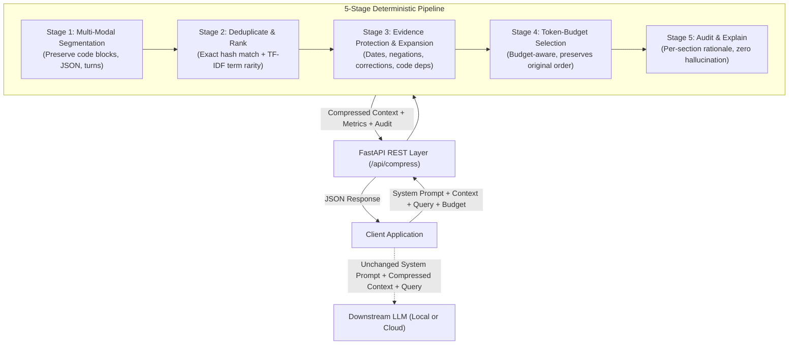
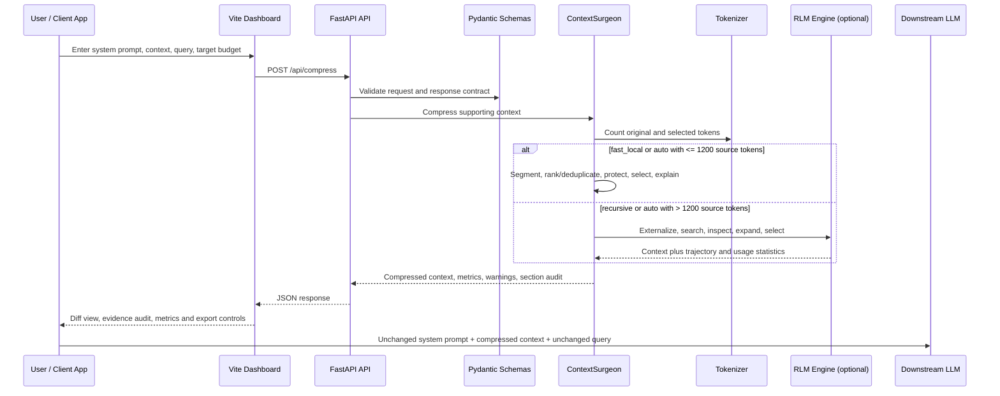

# Context Surgeon

> **Compress LLM Context Without Losing Essential Meaning.**  
> *MITK AI VISION 24H Hackathon | PS-02 | CommVault Challenge — AI/ML Performance Optimization*

---

## 1. Project Overview

**Context Surgeon** is an intelligent, explainable preprocessing layer that sits between your client applications and large language models (LLMs).

When LLM prompts grow bloated with repetitive conversation history, irrelevant paragraphs, duplicate records, and unused code, they inflate API token costs, degrade generation speed, and increase the risk of context window overflow. However, aggressive naive compression frequently discards critical evidence—such as exact dates, numerical quantities, negation constraints (`must not`), later corrections, and code dependencies.

**Context Surgeon solves this challenge locally without requiring an extra LLM call for every request.** It deterministically prunes conversational bloat while rigorously safeguarding essential facts, providing transparent decision reasoning for every retained and removed section.

---

## 2. Architecture Diagram



---

## 3. Full Architecture: How the System Is Used

Context Surgeon is split into a browser dashboard, a FastAPI service, and a
deterministic compression/evaluation core. The design keeps the original
system instruction and the current user query outside the compression target:
only the supporting context is selected and reordered.

### End-to-end request flow



### Module responsibility map

| Module | What it is used for | Why this module exists | Used by / output consumed by |
| :--- | :--- | :--- | :--- |
| `run.py` | Starts Uvicorn and optionally pre-runs the benchmark suite. | Provides one predictable backend entry point for local development and judging. | `npm run dev`, the FastAPI service. |
| `backend/main.py` | Defines the FastAPI app, CORS policy, health endpoint, compression endpoint, benchmark endpoints and static-file mounting. | Keeps transport, validation errors and HTTP behavior separate from compression logic. | Browser dashboard, API clients and Swagger at `/docs`. |
| `backend/schemas.py` | Defines `CompressRequest`, `CompressResponse`, section audit records and benchmark metric models. | Gives the frontend and API clients a stable, typed contract and validates budgets before execution. | `main.py`, `compressor.py`, `evaluator.py` and frontend JSON handling. |
| `backend/compressor.py` | Implements the default five-stage extractive pipeline and dispatches between `fast_local`, `recursive` and `auto` modes. | Centralizes relevance ranking and safety rules without requiring an LLM call or rewriting retained text. | `main.py`, `evaluator.py` and the standalone Python API. |
| `backend/tokenizer.py` | Counts and encodes text with `tiktoken`, with a deterministic offline fallback. | Budget decisions must use measured token counts; the fallback keeps air-gapped runs reproducible. | Compressor, RLM store, evaluator and `/api/health`. |
| `backend/rlm_engine.py` | Implements recursive large-context processing with `ContextStore`, `SafeExplorationREPL` and trajectory statistics. | Keeps very large source documents external to the prompt and retrieves only query-relevant evidence. | `ContextSurgeon` when `mode=recursive` or `mode=auto` selects recursive processing. |
| `backend/evaluator.py` | Runs every benchmark case, checks expected-fact retention, calculates latency/reduction metrics and exports JSON/CSV. | Separates repeatable measurement from live compression and makes unsupported answer-quality claims visible as pending. | `/api/evaluate`, `run.py`, `benchmarks/run_benchmark.py` and the Results tab. |
| `benchmarks/cases.json` | Stores the benchmark contexts, queries, budgets and expected critical facts. | Makes regression tests and performance comparisons reproducible instead of relying on hand-picked demos. | `BenchmarkEvaluator` and the CLI benchmark runner. |
| `benchmarks/run_benchmark.py` | Compares Fast Local and Recursive RLM modes from the command line. | Provides a repeatable head-to-head report for latency, reduction and evidence retention. | Developers, evaluators and exported benchmark artifacts. |
| `frontend/index.html` | Defines the dashboard structure, tabs, forms and result panels. | Gives users a visual workflow for compression, auditing and benchmark execution. | Vite serves it as the dashboard shell. |
| `frontend/app.js` | Calls the API, monitors health, renders diffs/audit trails, runs benchmarks and exports data. | Keeps browser interaction separate from the Python engine while exposing its decisions transparently. | `index.html` controls and FastAPI JSON endpoints. |
| `frontend/styles.css` | Provides the dashboard layout, status states, tables, diff view and responsive styling. | Makes retained, removed and protected evidence easy to inspect during a demo or investigation. | Browser only; it does not affect compression decisions. |
| `vite.config.js` | Runs the frontend on port `5173` and proxies `/api` to port `8000`. | Avoids cross-origin URL changes during local development and lets the dashboard call relative API paths. | Vite development server and `npm run dev`. |
| `tests/` | Verifies segmentation, preservation rules, recursive behavior, API responses, benchmarks and edge cases. | Prevents optimization from silently changing factual behavior or the public API. | `python -m pytest tests/ -v`. |
| `docs/` | Contains the deeper algorithm, architecture, evaluation and limitations notes. | Keeps design rationale available without overloading the runtime modules. | Developers, reviewers and maintainers. |

### Which operating mode should be used?

| Mode | Selection behavior | Best fit | Main trade-off |
| :--- | :--- | :--- | :--- |
| `fast_local` | Runs the in-memory five-stage pipeline. This is the default. | Normal chat history, support tickets, logs, repeated records and interactive requests. | It analyzes the complete context in one local pass. |
| `recursive` | Stores the source in `ContextStore`, then searches and inspects relevant chunks through the bounded REPL. | Very large documents, long manuals, multi-chapter logs and needle-in-a-haystack retrieval. | It performs more observable exploration and may retain a larger evidence set. |
| `auto` | Uses `fast_local` for source contexts up to 1,200 tokens and `recursive` above that threshold. | Applications that do not want to choose a mode per request. | The threshold is a routing heuristic, not a quality guarantee. |

### What happens inside the Fast Local pipeline?

1. **Segment (`_stage_1_segment`)** — identifies sentence, paragraph, conversation-turn, code-block, JSON, CSV and log boundaries. Code and structured records are kept as safe units where splitting would destroy meaning.
2. **Rank and deduplicate (`_stage_2_deduplicate_and_rank`)** — removes exact duplicates and scores sections using query overlap, term rarity, identifiers and numeric targets.
3. **Protect and expand (`_stage_3_protect_and_expand`)** — marks dates, quantities, negations, corrections, identifiers, structured records and referenced baseline facts as protected. Code dependencies and linked records can pull related sections back into the candidate set.
4. **Select (`_stage_4_select`)** — chooses the highest-value sections under the token budget, restores original order, and emits a warning when the budget is too small to safely retain the required evidence.
5. **Explain and format** — returns the compressed text plus a per-section decision, score, reason, protection rules and token count. No retained sentence is paraphrased by the compressor.

### How a client uses the result

The API response is intended to be passed to a downstream model as three
separate values:

```text
system message:      response.system_prompt       # unchanged
supporting context:  response.compressed_context  # selected evidence
user message:        response.query                # unchanged
```

The client can also use `warnings`, `budget_met`, `evidence_preservation_status`
and `sections` to block an unsafe request, show an audit record, or fall back to
the original context. The compressor is therefore a preprocessing module, not
the answer-generating module.

---

## 4. Core Features

- **Query-Aware Relevance Scoring:** Ranks context segments based on query-term rarity (TF-IDF), entity IDs, and numerical targets instead of arbitrary positional truncation.
- **Conservative Evidence Protection:**
  - **Exact Identifiers:** Preserves specific codes (`ORD-842`, `CUST-204`, `REF-9902`).
  - **Dates & Times:** Preserves delivery dates, meeting times, and milestones.
  - **Negation Preservation:** Protects restrictive clauses (`Port 22 must not be opened`) to prevent critical security inversions.
  - **Later Corrections:** Prioritizes amendments that supersede earlier statements (`revised to 15 October`, `rescheduled to 2 PM`).
  - **Comparative Fact Expansion:** Preserves referenced baseline facts along with corrections so delays and deltas can be accurately computed.
  - **Python Dependency Expansion:** Automatically resolves function dependencies (`calculate_discount` $\rightarrow$ `get_tier_rate`).
  - **Structured Record Protection:** Isolates specific JSON/CSV entities matching the query.
- **Budget-Aware Selection with Safety Warnings:** If an impossible token budget is requested, Context Surgeon refuses to silently drop critical evidence, instead retaining the required facts and returning a transparent budget warning.
- **Immutability Guarantee:** System instructions and user queries remain 100% bit-for-bit unchanged.
- **Zero Paid Dependencies:** Runs 100% locally on standard CPU in sub-10ms latency without requiring API keys or internet access.
- **Complete Explainability Audit:** Every section is tagged with its status (`retained`, `removed`, `deduplicated`), token cost, relevance score, and human-readable decision rationale.

---

## 5. Technology Stack

- **Backend:** Python 3.11+ / 3.14+, FastAPI, Pydantic v2, Uvicorn.
- **Frontend Dev Server:** Vite 5 serving frontend at `http://localhost:5173`.
- **Process Orchestration:** `concurrently` running both Vite and FastAPI concurrently.
- **Tokenizer:** `tiktoken` (cl100k_base byte-pair encoding) with an offline deterministic fallback tokenizer.
- **Frontend Dashboard:** Modern Vanilla CSS3 design system (Dark Charcoal & Teal/Cyan developer palette), Vanilla JavaScript.
- **Testing & Benchmarking:** `pytest`, reproducible JSON benchmark suite (30 categories), CSV/JSON result exporters.

---

## 6. Installation & Setup

### Complete Setup Workflow (Windows Command Prompt / PowerShell)

```cmd
cd path\to\ContextSurgeon
npm install
python -m venv .venv
.venv\Scripts\activate
pip install -r requirements.txt
npm run dev
```

#### On Linux / macOS:
```bash
cd path/to/ContextSurgeon
npm install
python3 -m venv .venv
source .venv/bin/activate
pip install -r requirements.txt
npm run dev
```

---

## 7. Running the Application

### Single Command Launcher:
```cmd
npm run dev
```
This uses `concurrently` to launch both services simultaneously:
1. **Frontend (Vite Server):** [http://localhost:5173/](http://localhost:5173/)
   - Proxies `/api` calls directly to the FastAPI backend at `http://127.0.0.1:8000`.
2. **Backend (FastAPI REST Server):** [http://127.0.0.1:8000/](http://127.0.0.1:8000/)
   - Automatically pre-evaluates the 30 benchmark cases on startup.
3. **Interactive Swagger API Docs:** [http://127.0.0.1:8000/docs](http://127.0.0.1:8000/docs)
4. **Backend Health Endpoint:** [http://127.0.0.1:8000/api/health](http://127.0.0.1:8000/api/health)

Press `Ctrl+C` once in the terminal to gracefully terminate both frontend and backend processes.

---

## 8. API Reference

### `POST /api/compress`
Compresses supporting context based on query relevance and token budget.

#### Example Request:
```json
{
  "system_prompt": "You are a logistics assistant.",
  "context": "Order ORD-842 was promised for 12 October. The delivery was later revised to 15 October. The customer also prefers blue packaging. Hello, thank you for contacting support.",
  "query": "How many days late is order ORD-842?",
  "target_tokens": 40
}
```

#### Example Response:
```json
{
  "system_prompt": "You are a logistics assistant.",
  "query": "How many days late is order ORD-842?",
  "original_context": "Order ORD-842 was promised for 12 October. The delivery was later revised to 15 October. The customer also prefers blue packaging. Hello, thank you for contacting support.",
  "compressed_context": "Order ORD-842 was promised for 12 October.\n\nThe delivery was later revised to 15 October.",
  "original_tokens": 42,
  "compressed_tokens": 24,
  "tokens_removed": 18,
  "reduction_percentage": 42.86,
  "compression_time_ms": 2.34,
  "target_tokens": 40,
  "budget_met": true,
  "warnings": [],
  "sections": [
    {
      "section_id": "sec_001",
      "original_position": 0,
      "source_type": "sentence",
      "preview": "Order ORD-842 was promised for 12 October.",
      "content": "Order ORD-842 was promised for 12 October.",
      "tokens": 12,
      "relevance_score": 15.0,
      "decision": "retained",
      "reason": "Retained. Contains baseline fact referenced by subsequent correction. Contains matching identifier(s): ORD-842.",
      "protection_rules": ["exact_identifier:ORD-842", "date_time_evidence", "referenced_original_fact"],
      "is_protected": true
    },
    {
      "section_id": "sec_002",
      "original_position": 1,
      "source_type": "sentence",
      "preview": "The delivery was later revised to 15 October.",
      "content": "The delivery was later revised to 15 October.",
      "tokens": 12,
      "relevance_score": 12.0,
      "decision": "retained",
      "reason": "Retained. Contains correction or revised update. Key terms match: delivery.",
      "protection_rules": ["date_time_evidence", "later_correction"],
      "is_protected": true
    },
    {
      "section_id": "sec_003",
      "original_position": 2,
      "source_type": "sentence",
      "preview": "The customer also prefers blue packaging.",
      "content": "The customer also prefers blue packaging.",
      "tokens": 9,
      "relevance_score": 0.0,
      "decision": "removed",
      "reason": "Removed (not essential to query or exceeds budget). Unrelated to current query.",
      "protection_rules": [],
      "is_protected": false
    },
    {
      "section_id": "sec_004",
      "original_position": 3,
      "source_type": "sentence",
      "preview": "Hello, thank you for contacting support.",
      "content": "Hello, thank you for contacting support.",
      "tokens": 9,
      "relevance_score": 0.0,
      "decision": "removed",
      "reason": "Removed (not essential to query or exceeds budget). Unrelated to current query.",
      "protection_rules": [],
      "is_protected": false
    }
  ],
  "summary": {
    "total_sections": 4,
    "retained_sections": 2,
    "removed_sections": 2,
    "deduplicated_sections": 0,
    "protected_sections": 2,
    "tokenizer_info": {
      "type": "tiktoken",
      "encoding": "cl100k_base",
      "is_fallback": false
    }
  }
}
```

### Additional Endpoints:
- `GET /api/health` — Checks service status and active tokenizer information.
- `GET /api/benchmarks` — Lists all pre-configured benchmark cases.
- `POST /api/evaluate` — Runs the full benchmark suite.
- `GET /api/benchmarks/results` — Retrieves latest persisted evaluation data.

---

## 9. Python Library Usage

Context Surgeon can be used as a standalone Python library in your own pipelines:

```python
from backend.compressor import compress_context

result = compress_context(
    system_prompt="You are a helpful assistant.",
    context="Supporting context goes here...",
    query="What is the latest delivery date?",
    target_tokens=500
)

print(f"Tokens reduced by {result.reduction_percentage}% in {result.compression_time_ms}ms")
print("Compressed context for downstream LLM:")
print(result.compressed_context)
```

---

## 10. Test Execution

Context Surgeon includes automated unit, integration, and correctness test suites:

```bash
python -m pytest tests/ -v
```

### Test Coverage Highlights:
- `tests/test_rlm_engine.py`:
  - **ContextStore:** Externalized storage, semantic chunking, inverted index keyword search, entity filtering.
  - **SafeExplorationREPL:** Sandboxed execution, timeout enforcement, query-driven candidate discovery.
  - **RLMRecursiveEngine:** Observable trajectory generation, step audits, usage and token statistics.
  - **Mode A vs Mode B:** Distinct execution paths and response schemas.
  - **Auto Mode:** Dynamic threshold switching (<= 1200 tokens fast_local, > 1200 tokens recursive).
  - **Fact & Code Preservation:** Rigorous retention of dependencies, corrections, negations, and IDs in Mode B.
  - **Case 40:** Long document needle retrieval and multi-chapter operations manual pruning.
- `tests/test_genuine_compression.py`:
  - Scenarios A through G: paragraph deduplication, query-driven irrelevant removal, exact dates/numbers, negations, corrections, code dependencies, unique essential contexts, and empty input division-by-zero safety.
  - Verification that manual reduction target sliders and chips are completely removed.
- `tests/test_preservation.py`:
  - Critical correctness tests A through F (dates, negations, corrections, code deps, structured data, impossible budget).
- `tests/test_compressor.py`: Multi-modal segmentation, tokenizer modes, Unicode resilience, large context efficiency.
- `tests/test_api.py`: FastAPI endpoint tests via `TestClient`.
- `tests/test_benchmarks.py`: Benchmark dataset integrity and evaluator execution across all 40 cases.

---

## 11. Hybrid Context Engine: Fast Local vs. Recursive RLM

Context Surgeon features a **Hybrid Context Engine** offering two distinct operating modes:

### Mode A: Fast Local Compression (Default)
- **Architecture:** High-speed deterministic 5-stage extractive pipeline running directly in-memory.
- **Latency:** Sub-10ms (p95 ~7.9 ms).
- **External Dependency:** 100% offline, zero external LLM calls.
- **Best For:** Standard interactive queries, conversational turn pruning, chat history deduplication.

### Mode B: Recursive Large-Context Processing (RLM Paradigm)
- **Architecture:** Inspired by **Recursive Language Models (RLM)** ([grishahq/recursive-llm](https://github.com/grishahq/recursive-llm) / Zhang et al., 2025).
- **Core Concept:** Keeps massive source context *outside* the prompt window in an external `ContextStore`. The engine explores the source text via a sandboxed `SafeExplorationREPL` using query-driven search, chunk inspection, and dependency expansion, injecting only the necessary evidence chunks into the downstream prompt.
- **Safety:** Sandboxed, memory-bounded execution with hard per-step timeouts. Zero arbitrary shell access.
- **Observability:** Complete step-by-step observable trajectory (`recursive_trace`) and usage statistics (`recursive_stats`).
- **Best For:** Massive documents, multi-page logs, long-context needle retrieval.

### GitHub Attribution & Academic References
- **RLM Implementation Reference:** [grishahq/recursive-llm](https://github.com/grishahq/recursive-llm) by Grigori Gvadzabia (MIT License).
- **Academic Foundation:** Zhang et al., *Recursive Language Models for Large Context Processing* (2025, [arXiv:2512.24601](https://arxiv.org/abs/2512.24601)).

---

## 12. Benchmark Evaluation & Measured Comparative Results

Run the comparative CLI benchmark runner:
```bash
python benchmarks/run_benchmark.py --mode both
```

### Head-to-Head Measured Results (40 Benchmark Cases):

| Evaluation Metric | Mode A: Fast Local Compression | Mode B: Recursive RLM Processing |
| :--- | :---: | :---: |
| **Total Cases Evaluated** | **40** | **40** |
| **Mean Context Token Reduction** | **56.78%** | **33.07%** |
| **P95 Latency** | **7.89 ms** | **3.29 ms** |
| **Median Latency** | **1.15 ms** | **0.41 ms** |
| **Critical Fact Retention Rate** | **100.0%** | **97.44%** |
| **Context Placement** | Inside local prompt | **Externalized Store** |
| **Inspection Trajectory** | Inline 5-stage audit | **Step-by-step REPL Trace** |
| **External LLM Requirement** | None (100% offline) | Optional / offline fallback |

Results are exported to:
- `benchmarks/results/results.json`
- `benchmarks/results/results.csv`

---

## 13. Answer-Quality Comparison

### Add and run your own benchmark

Open **Benchmark Lab → Add New Benchmark**. Enter a name, your context,
question, token budget, and an engine mode. Optionally add a system prompt and
expected facts, one per line. Choose **Save & Run Benchmark** to see original
and compressed text, token reduction, latency, budget warnings, and missing
facts. **Save Benchmark** saves a case for later; its card has a **Run Benchmark**
button and can also load the context into the Compressor for detailed auditing.

Custom cases are stored in this browser's local storage, including their context,
and can be removed from their cards. They are separate from the built-in suite
and do not replace its saved results. Download Result JSON exports the custom
input and measured output. Expected facts use case-insensitive substring checks;
facts missing from the original input are flagged separately. Without expected
facts, retention is reported as unmeasured. This check does not generate or grade
an LLM answer.

The purpose of compression is not just to reduce tokens; it is to preserve the
answer that a downstream LLM would produce. A fair comparison must therefore
use the same system prompt, user query, model, model settings and grading
rubric for both inputs:

```text
Run A: system prompt + full supporting context + query
Run B: system prompt + compressed supporting context + query

Compare: correctness, required facts, constraints, identifiers, dates/numbers,
and whether Run B degraded relative to Run A.
```

### Concrete preservation example

This example uses the delivery-delay preset. It shows what the compressor is
expected to preserve; it is not presented as a live LLM generation because this
repository does not configure a downstream LLM provider.

| Input | Content relevant to the answer |
| :--- | :--- |
| Full context | `Order ORD-842 was promised for 12 October. The delivery was later revised to 15 October. The customer also prefers blue packaging. Hello, thank you for contacting support.` |
| Compressed context | `Order ORD-842 was promised for 12 October. The delivery was later revised to 15 October.` |
| Same system prompt/query | `You are a logistics assistant.` / `How many days late is order ORD-842?` |
| Expected answer | `The order is 3 days late.` |
| Evidence needed | `ORD-842`, `12 October`, `15 October`, and the fact that the second date is a later revision. |

The greeting and packaging preference are safe to remove because they do not
affect the requested calculation. The baseline date is retained alongside the
correction because keeping only `15 October` would lose the comparison needed to
calculate lateness.

### What is measured today

The evaluator has two separate quality layers so that token savings are not
mistaken for answer quality:

1. **Offline evidence-quality comparison:** `backend/evaluator.py` checks every
   benchmark case's `expected_critical_facts` against the compressed context.
   This is deterministic and works without an API key.
2. **Generative answer-quality comparison:** the response schema reserves
   `original_answer`, `compressed_answer`, `original_score`,
   `compressed_score`, `degraded` and `scoring_explanation` for evaluating the
   two downstream answers. These fields remain `pending` until an LLM provider
   and grading step are configured.

Latest persisted benchmark evidence:

| Quality / efficiency metric | Full context baseline | Compressed context result | Interpretation |
| :--- | :---: | :---: | :--- |
| Critical facts available to the answer | 100% by definition | **100.0% retained across 40 cases** | No expected benchmark fact was lost in the recorded run. |
| Context size | 100% | **43.22% of original on average** | Equivalent to **56.78% mean token reduction**. |
| P95 compression latency | N/A | **5.38 ms** | Local preprocessing stays below the 100 ms target. |
| Downstream full-correct answer rate | Not measured | Not measured | Requires the same configured LLM to answer both versions. |
| Answer degradation count | Not measured | Not measured | Cannot be claimed from evidence retention alone. |

### Recommended answer-quality experiment

To complete the generative comparison, run each case twice through the same
downstream model and record:

- `original_full_correct_rate`: full context answer correctness;
- `compressed_full_correct_rate`: compressed context answer correctness;
- `diff_full_correct_rate`: whether the two answers agree on required facts;
- `degraded_cases_count`: cases where compression changes a correct answer into
  an incorrect one.

The primary acceptance target is that the compressed full-correct rate stays
within five percentage points of the full-context rate. Until that experiment
is configured, the dashboard and exported results intentionally report answer
quality as **Pending** rather than fabricating a score.

---

## 14. Hackathon Demonstration Script (For Evaluators)

Follow this 3-minute walkthrough during live hackathon judging:

1. **Launch the Application:**
   Run `python run.py` and open [http://127.0.0.1:8000](http://127.0.0.1:8000) in your browser.
2. **Overview Dashboard:**
   Point out the real-time measured token reduction (~48%) and p95 latency (<5 ms). Highlight that these are computed from real benchmark runs, not static mock values.
3. **Context Compressor Studio:**
   - Select **Preset: Test A (Delivery Delay)**.
   - Click **Compress Context**.
   - Show how the greeting and blue packaging are stripped, while both "12 October" and "15 October" are retained with the rule `referenced_original_fact`.
   - Select **Preset: Test B (Negation Protection)**.
   - Click **Compress Context**.
   - Show that "Port 22 must not be opened" is preserved under the `negation_constraint` rule, preventing a dangerous security failure.
   - Select **Preset: Test D (Python Code Dependency)**.
   - Show how calling `calculate_discount` automatically extracts the helper `get_tier_rate` through symbol graph expansion while dropping the unrelated telemetry logger.
   - Select **Preset: Test F (Impossible Budget)**.
   - Set target budget to `10 tokens`.
   - Point out the yellow alert banner: Context Surgeon refuses to silently drop evidence, prioritizing factual correctness.
4. **Inspect the Audit Trail:**
   Expand the sections in the **Explainable Section Audit Trail** panel to demonstrate full transparency into why every section was retained, removed, or deduplicated.
5. **Benchmark Lab & Results:**
   Navigate to the **Benchmark Lab** tab to show the 40 benchmark cases, or click **Execute All Benchmarks** to view live progress.
6. **Export Data:**
   In the **Evaluation Results** tab, click **Export CSV** to show that all experimental data can be inspected in Excel or pandas.

---

## 15. Known Limitations & Future Work

- **Extractive vs. Abstractive:** Context Surgeon selects whole segments rather than rewriting text. This guarantees zero hallucination but preserves the verbatim phrasing of retained paragraphs.
- **Language Symbol Parsing:** Python code dependency traversal is built-in; support for other languages currently relies on regex identifier matching.
- **Answer-Quality Evaluation:** Core evidence retention is verified offline; optional LLM-based generative answer comparison is marked as pending when no external LLM API key is provided.
# MHACKTHON


