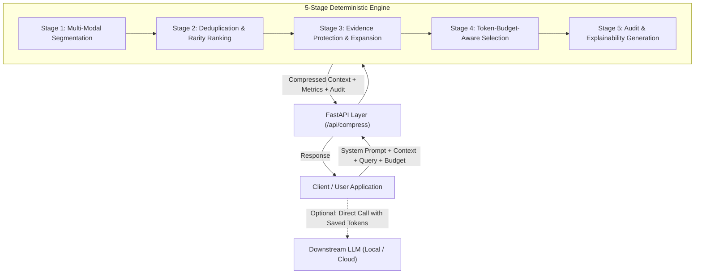

# Context Surgeon — System Architecture

**Context Surgeon** is an explainable, query-aware context compression layer designed to sit transparently between client applications and large language models (LLMs).

## High-Level Architecture Diagram

## Core Architectural Components

### 1. Preprocessing Layer Isolation
Context Surgeon enforces a strict boundary condition:
- **System Prompt:** Preserved bit-for-bit unchanged.
- **Current User Query:** Preserved bit-for-bit unchanged.
- **Supporting Context:** Extensively analyzed, segmented, and compressed.

This prevents prompt injection risks from silently modifying instructions, and prevents hallucinations where an LLM rewriter might paraphrase or corrupt sensitive prompt instructions.

### 2. Dual Tokenizer Engine
Located in `backend/tokenizer.py`:
- **Primary:** `tiktoken` byte-pair encoding (`cl100k_base` / `o200k_base`) providing token counts aligned with modern frontier LLMs.
- **Deterministic Offline Fallback:** Regex-based subword heuristic (~3.8 to 4.2 characters per token) with integer subword mapping for air-gapped environments without external tokenizers.

### 3. State-Free, Low-Latency Engine
The compression engine is purely deterministic and stateless:
- Requires **zero external API calls** to run the core compression.
- Runs on local CPU in sub-10 milliseconds for common context lengths.
- Safely scales to large contexts (tested up to 10,000+ tokens) with sub-100ms p95 latency.

### 4. Downstream Evaluation Pipeline
Located in `backend/evaluator.py`:
- Reproducible benchmark processing over 30 test categories.
- Measures token reduction, p95/median latency, and critical fact retention rates.
- Pluggable answer quality evaluation: if an LLM is not configured, offline fact-retention is tested and answer quality is transparently marked pending rather than fabricated.
